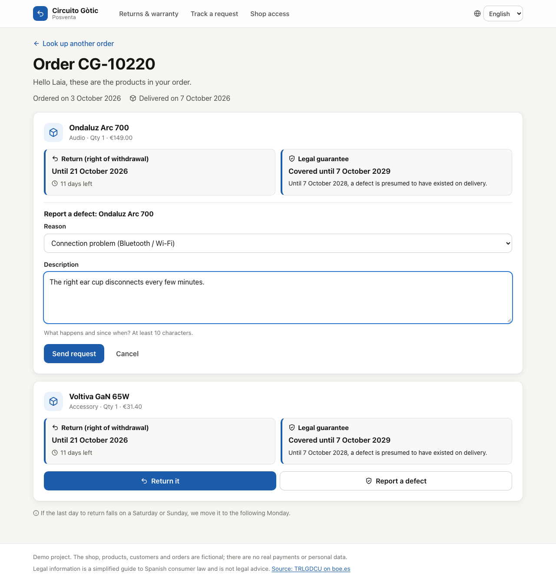
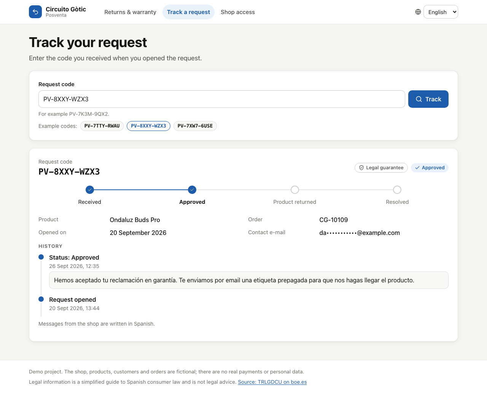
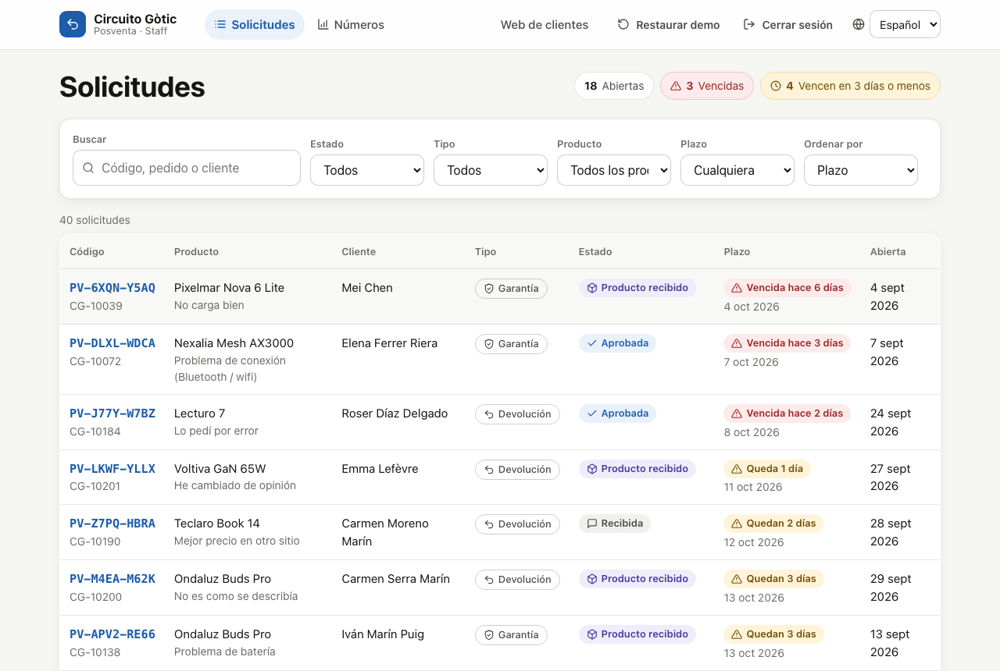
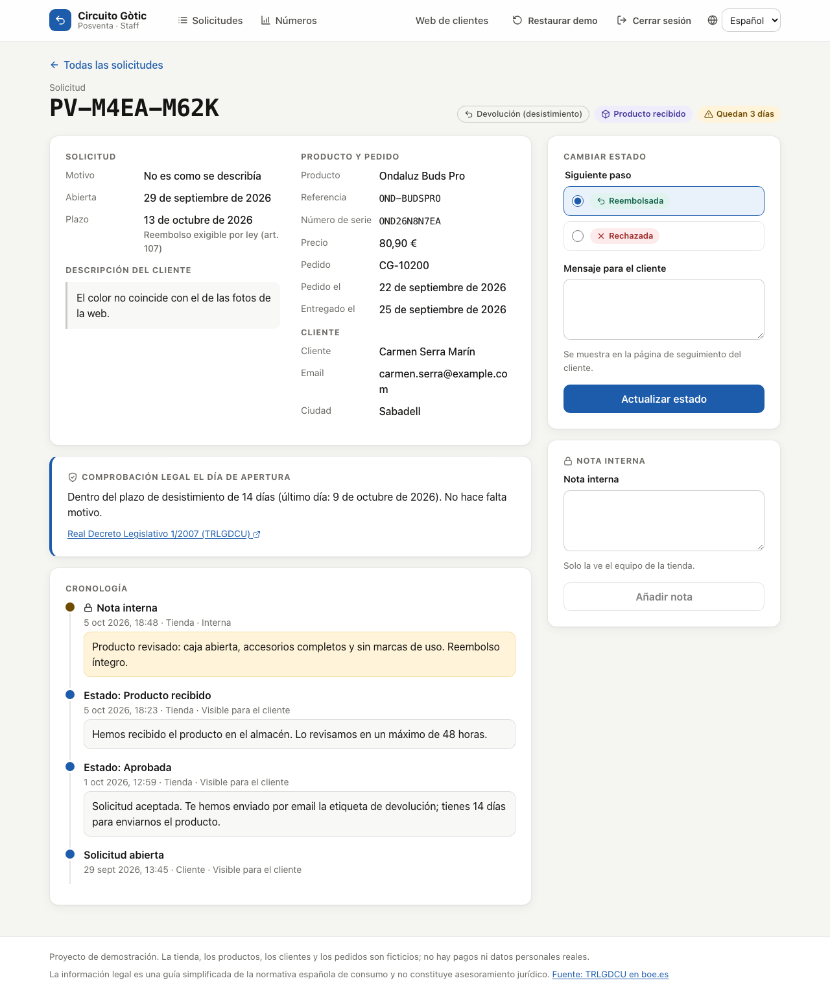
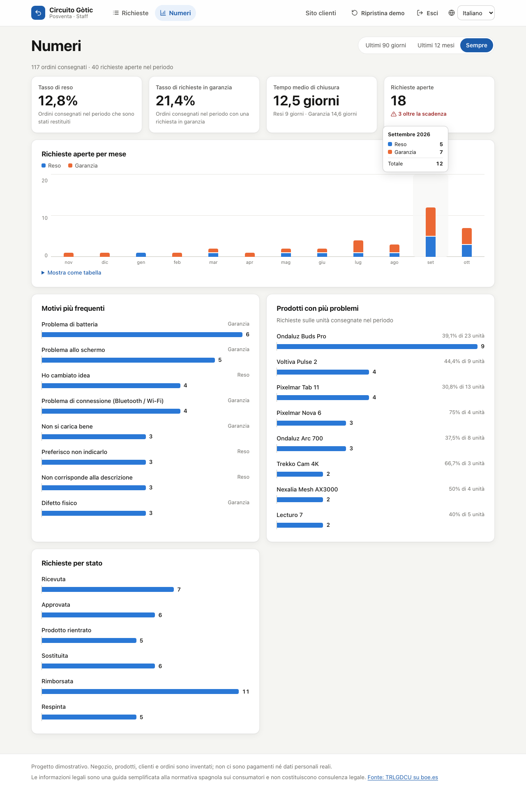
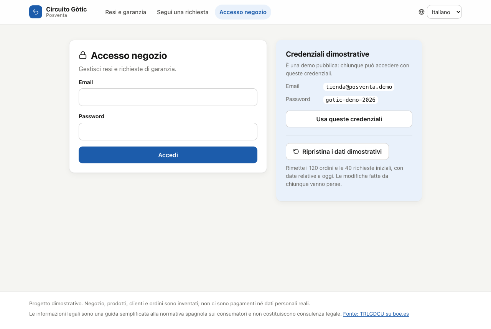
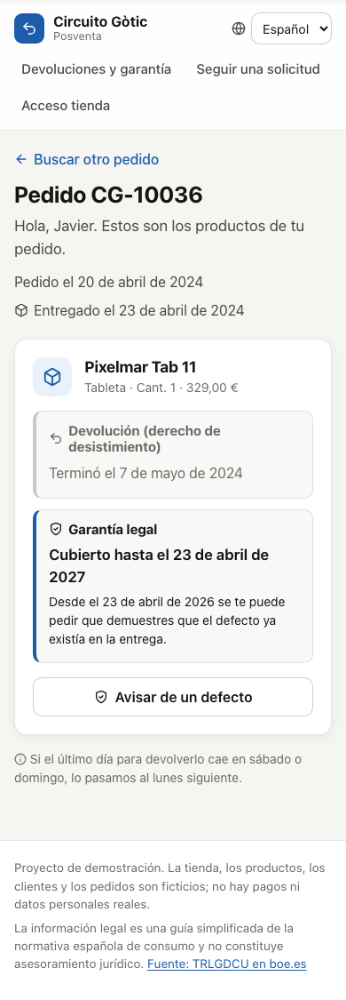
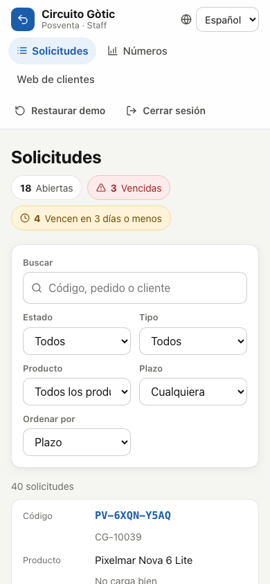
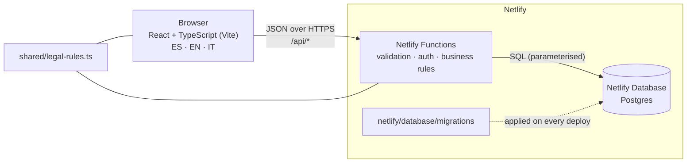
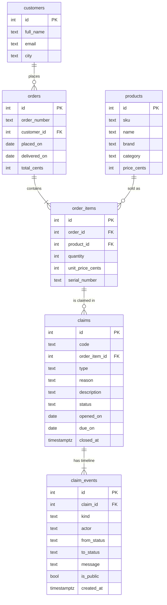

# Posventa — returns and warranty desk for a small online electronics shop in Spain

[](https://github.com/stefanopisani91/posventa/actions/workflows/ci.yml)

**Live demo: https://posventa-circuito-gotic.netlify.app**

Posventa is the after-sales tool of *Circuito Gòtic*, a fictional online electronics shop in Barcelona.
Customers check what Spanish consumer law entitles them to for each product they bought — the
14-day right of withdrawal or the 3-year legal guarantee, with the exact deadlines — open a request
and follow it with a code. The shop team works through a queue sorted by legal deadline, records
every step, and sees which products cause the most problems.

The interface is available in **Spanish, English and Italian** and works on a phone.

## Try it

| What | How |
| --- | --- |
| Customer side | Open the [home page](https://posventa-circuito-gotic.netlify.app/) and pick one of the example orders |
| Shop side | [Shop access](https://posventa-circuito-gotic.netlify.app/staff/login) with **`tienda@posventa.demo`** / **`gotic-demo-2026`** (also shown on the login page) |
| Track a request | [Tracking page](https://posventa-circuito-gotic.netlify.app/track), e.g. `PV-8XXY-WZX3` |
| Start over | "Restore demo data" on the login page puts back the initial 120 orders and 40 requests |

Example orders (order number / e-mail):

| Order | E-mail | Situation |
| --- | --- | --- |
| `CG-10220` | `laia.puig@example.com` | Delivered 3 days ago: return and warranty available |
| `CG-10225` | `marco.rinaldi@example.com` | Still in transit: return already possible |
| `CG-10084` | `nuria.soler@example.com` | ~14 months: warranty, defect presumed to exist at delivery |
| `CG-10036` | `javier.ortega@example.com` | ~2½ years: warranty, no presumption any more |
| `CG-10004` | `camille.laurent@example.com` | Over 3 years: nothing left to claim |
| `CG-10137` | `pau.riera@example.com` | Already has an open request |

Dates are generated relative to the day the data is restored, so these situations stay true over time.

## Screenshots

| Customer: options for an order | Customer: tracking |
| --- | --- |
|  |  |

| Shop: request queue | Shop: request detail |
| --- | --- |
|  |  |

| Shop: numbers | Login with demo credentials |
| --- | --- |
|  |  |

| Phone: order | Phone: queue |
| --- | --- |
|  |  |

## What it does

**Customers (public)**

- Find an order with its number and e-mail address. The same error is shown for a wrong number and
  a wrong e-mail, so order numbers cannot be probed.
- For every product: last day to return it, days left, warranty end date and until when a defect is
  presumed to have existed at delivery.
- Open a return (no reason required, as the law says) or a warranty claim (reason and description
  required) and receive a code such as `PV-7K3M-9QX2`.
- Follow the request with the code: progress, dates and the shop's messages. Internal notes and
  personal data are never shown (the e-mail is masked).

**Shop (login required)**

- Queue with counters (open, overdue, due in 3 days), search, and filters by status, type, product
  and deadline. Filters live in the URL, so a filtered view can be bookmarked or shared.
- Request page: customer, product, serial number, order dates, the legal position on the day the
  request was opened, full timeline, status change with an optional message for the customer, and
  internal notes.
- Status workflow enforced by the server: received → approved → product returned → replaced or
  refunded; rejected at any point before closing, with a mandatory explanation. A return can never
  end in "replaced". If two people edit the same request, the second gets a clear conflict message
  instead of silently overwriting.
- Numbers: return rate, warranty claim rate, average time to close, open and overdue requests,
  requests per month, most frequent reasons, products with most problems, requests by status — for
  the last 90 days, 12 months or all time. Each chart has a table view.

## Spanish legal rules

All legal values live in one file, [`shared/legal-rules.ts`](shared/legal-rules.ts), used by both the
browser and the server. They were checked against the consolidated text of the
**Real Decreto Legislativo 1/2007, Texto refundido de la Ley General para la Defensa de los
Consumidores y Usuarios (TRLGDCU)** on the Spanish Official State Gazette (BOE), version of
28 February 2026.

| Rule | Value | Source |
| --- | --- | --- |
| Right of withdrawal for distance sales, no reason needed | 14 calendar days | [art. 102](https://www.boe.es/buscar/act.php?id=BOE-A-2007-20555#a102) |
| Withdrawal period starts when the consumer receives the goods | delivery date | [art. 104](https://www.boe.es/buscar/act.php?id=BOE-A-2007-20555#a104) |
| Shop refunds within … of being informed | 14 days | [art. 107](https://www.boe.es/buscar/act.php?id=BOE-A-2007-20555#a107) |
| Legal guarantee for goods (lack of conformity) | 3 years from delivery | [art. 120](https://www.boe.es/buscar/act.php?id=BOE-A-2007-20555#a120) |
| Defect presumed to have existed at delivery | first 2 years | [art. 121](https://www.boe.es/buscar/act.php?id=BOE-A-2007-20555#a121) |
| Repairs suspend the periods; same defect covered 1 more year after repair | — | [art. 122](https://www.boe.es/buscar/act.php?id=BOE-A-2007-20555#a122) |

Plain-language official source: European Consumer Centre Spain (Ministry of Consumer Affairs),
[*Derecho a devolver las compras realizadas a distancia*](https://portal-cec.consumo.gob.es/sites/default/files/documentos/FOLLETO_DERECHO_DESISTIMIENTO_JULIO_2026.pdf) (July 2026).
The 3-year period was introduced by [Real Decreto-ley 7/2021](https://www.boe.es/buscar/doc.php?id=BOE-A-2021-6872).

How dates are computed (tested in [`shared/eligibility.test.ts`](shared/eligibility.test.ts)):

- The delivery day is not counted: delivered on 1 March → last day to return is 15 March
  ([Directive 2011/83/EU](https://eur-lex.europa.eu/legal-content/EN/TXT/?uri=CELEX:32011L0083),
  recital 41, which applies Regulation 1182/71 on periods and dates).
- If that last day is a Saturday or Sunday, it moves to Monday (Regulation 1182/71, art. 3(4)) —
  never worse for the customer. Public holidays are not modelled.
- A delivery on 29 February has its warranty end on 28 February three years later.
- Dates use the shop's calendar (Europe/Madrid), not the server's.

Not modelled: the exceptions of art. 103 (personalised goods, unsealed hygiene items, unsealed
software…), the 12-month extension when the shop did not inform about withdrawal (art. 105), and
second-hand goods. The 30-day target for closing warranty claims is a shop policy
([`shared/shop-policy.ts`](shared/shop-policy.ts)); the law only says "within a reasonable time".

> **This app is not legal advice.** It is a simplified model for a demo, and the app says so on
> every page.

## Architecture

Everything runs on Netlify: a React single-page app served from the CDN, Netlify Functions as the
API, and Netlify Database (managed Postgres). The browser never talks to the database; every input
is validated on the server with [Zod](https://zod.dev).



```
src/                 React app (pages, components, i18n catalogues)
shared/              Code used by both sides: legal rules, deadline logic, types, input schemas
server/              Server-only code: DB access, auth, services, demo-data generator
netlify/functions/   One thin HTTP handler per area (public, staff, stats, demo)
netlify/database/    SQL migrations
tests/               API tests against an embedded Postgres
e2e/                 Playwright tests and screenshot script, run against the live site
```

### API

| Method & path | Who | Purpose |
| --- | --- | --- |
| `POST /api/orders/lookup` | public | Order + eligibility per product (rate-limited) |
| `POST /api/claims` | public | Open a return or warranty claim (rate-limited) |
| `GET /api/claims/:code` | public | Tracking: status and public timeline |
| `POST /api/admin/login` | public | Staff login, sets an HttpOnly session cookie (rate-limited) |
| `GET`/`DELETE /api/admin/session` | staff | Session check / logout |
| `GET /api/admin/claims` | staff | Queue with filters, search, sorting, paging |
| `GET /api/admin/claims/:id` | staff | Request detail with timeline |
| `POST /api/admin/claims/:id/status` | staff | Change status (with optional message to the customer) |
| `POST /api/admin/claims/:id/notes` | staff | Add an internal note |
| `GET /api/admin/stats?period=` | staff | Numbers for 90 days / 12 months / all |
| `GET /api/demo`, `POST /api/demo/reset` | public, demo mode only | Demo credentials and example orders; restore data |

### Database schema



Details in the [migration](netlify/database/migrations/20261010200000_initial_schema.sql):
check constraints for types, statuses and reasons; a partial unique index that allows only one
open request per order line; `claim_events` is an append-only log that feeds both the shop timeline
and (public events only) the customer's tracking page. `app_meta` stores when the demo data was
generated.

### Security

- Staff credentials and the session-signing key are Netlify environment variables, never in the
  repository. Sessions are HMAC-SHA256-signed cookies (`HttpOnly`, `Secure`, `SameSite=Lax`, 8 h).
- Mutating endpoints accept only same-origin `application/json` requests (CSRF protection).
- All SQL is parameterised; every request body and query string is validated with Zod.
- Login, order lookup and claim creation are rate-limited per IP (Netlify code-based rules).
- Claim codes are random (`crypto.randomInt`, ~10¹² combinations).

### Tests and CI

- **Deadline logic** — unit tests for calendar edge cases (weekends, 29 February, last day
  inclusive, time zones, configurable rules).
- **API** — every Function is called the way Netlify calls it, against an embedded
  Postgres-compatible database (`@netlify/database-dev`) with the real migrations: validation,
  eligibility, conflicts, auth, internal notes never leaking, stats, reset.
- **Demo data** — every generated request was legally possible on the day it was opened.
- **End-to-end** — Playwright runs the whole journey against the deployed site: a customer opens a
  return, the shop approves it, the page is reloaded to confirm the change is in the database, the
  customer sees the update but not the internal note, the three languages, the numbers page and the
  reset.
- GitHub Actions runs typecheck, lint, tests and build on every push.

## Run it locally

Requirements: Node.js 22 or newer.

```bash
npm install
cp .env.example .env          # then set a long random SESSION_SECRET
npm run dev                   # http://localhost:5173 — Vite + Netlify Functions + local database
# first time only, in a second terminal while `npm run dev` is running:
npx netlify-cli database migrations apply
```

The local database lives in `.netlify/` and is filled with demo data on the first request.

```bash
npm run ci                    # typecheck + lint + unit and API tests
npx playwright install chromium
npm run e2e                   # end-to-end tests against http://localhost:5173
BASE_URL=https://posventa-circuito-gotic.netlify.app npm run e2e    # …or against the live site
npm run e2e -- --project=screenshots                                # regenerate the README images
```

### Deploy your own copy

Create a Netlify project from the repository (build command `npm run build`, publish directory
`dist`) and set four environment variables: `ADMIN_EMAIL`, `ADMIN_PASSWORD`, `SESSION_SECRET`
(e.g. `openssl rand -hex 32`) and `DEMO_MODE=true`. On the first deploy Netlify creates the database
and applies the migrations. It runs on Netlify's free plan.

## What is fake

- The shop **Circuito Gòtic**, its 15 products and their brands (Ondaluz, Pixelmar, Teclaro,
  Voltiva, Sonoria, Lecturo, Trekko, Nexalia) are invented. Any resemblance to real brands is
  coincidental.
- The 90 customers are random combinations of common first names and surnames; all e-mail addresses
  use the reserved `example.com` domain. No real personal data is stored.
- The 120 orders and 40 requests are generated. The demo is deliberately request-heavy so that every
  status and situation appears; real return and claim rates would be much lower.
- There are no payments, no e-mails and no shipping labels: messages such as "we have e-mailed you a
  label" are part of the story.
- There is one shared staff account whose credentials are public.

## Limitations and next steps

- One shared staff account; a real shop would need personal accounts and an audit of who did what.
- Orders would come from the shop platform (Shopify, WooCommerce, PrestaShop…) instead of demo data.
- Automatic e-mails to the customer on every status change.
- Photo uploads for defects; return-label generation; public holidays in deadline calculations.
- Staff messages to customers are written in Spanish only.

---

I defined the requirements and reviewed the result; the code was written by directing AI agents (Claude Code).
